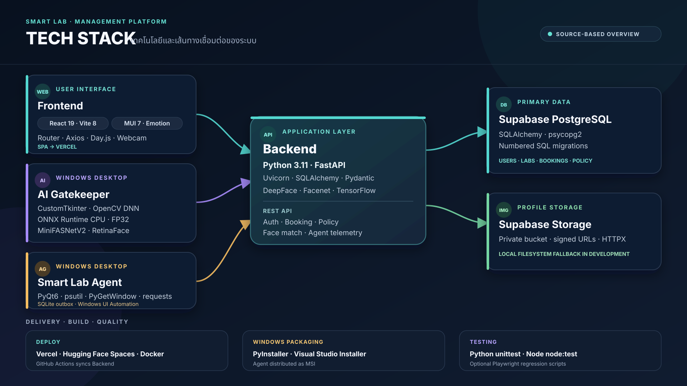
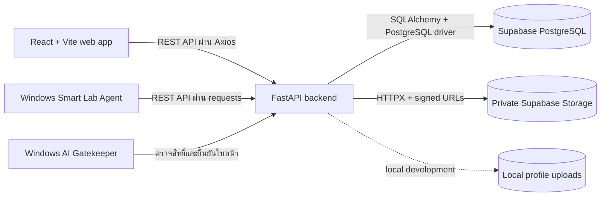

# Tech Stack ของ Smart Lab

สรุปเทคโนโลยีจาก source, dependency manifests และ deployment configuration ปัจจุบัน เวอร์ชันที่ระบุเป็นเวอร์ชันที่ประกาศไว้ใน manifest ของโปรเจกต์

## ภาพรวม

| ส่วน | Stack | หน้าที่ |
| --- | --- | --- |
| Frontend | JavaScript, React 19, Vite 8, Material UI 7 | Single-page web app สำหรับผู้ใช้และ Admin |
| Backend | Python 3.11, FastAPI, Uvicorn, SQLAlchemy 2, Pydantic 2 | REST API, authentication, booking, policy และข้อมูลของ Agent/Gatekeeper |
| Database | Supabase PostgreSQL, `psycopg2-binary`; SQL migrations | เก็บบัญชีผู้ใช้, Lab, booking, sessions, policy และประวัติ |
| Profile storage | Supabase Storage แบบ private ใน production; local filesystem สำหรับ development | เก็บรูปโปรไฟล์และส่ง signed URL ให้เว็บ |
| AI Gatekeeper | Python, CustomTkinter, OpenCV, ONNX Runtime CPU | แอป Windows สำหรับกล้อง, face detection และ liveness/anti-spoofing |
| Smart Lab Agent | Python, PyQt6, psutil, PyGetWindow, requests | แอป Windows สำหรับติดตามโปรแกรม/หน้าต่าง, ใช้นโยบาย Lab และส่ง telemetry |
| Build และ installer | PyInstaller; Visual Studio Installer Projects สำหรับ Agent MSI | สร้าง executable และ Windows installer |
| Deployment | Vercel, Hugging Face Spaces (Docker), GitHub Actions | ให้บริการ Frontend และ Backend แยกกัน |

## ภาพการเชื่อมต่อ

Frontend, Agent และ Gatekeeper เรียก Backend API แยกกันตามหน้าที่ Backend ใช้ PostgreSQL เป็นฐานข้อมูลหลัก ส่วนไฟล์รูปโปรไฟล์จัดเก็บใน filesystem ระหว่าง development หรือ Supabase Storage แบบ private ใน production

## Frontend

- React 19 และ Vite 8; source ใช้ JavaScript/JSX และ ES modules
- Material UI และ Emotion สำหรับ UI, React Router สำหรับ routing และ React Hook Form สำหรับแบบฟอร์ม
- Axios สำหรับเรียก Backend API, Day.js สำหรับวันที่ และ `react-webcam` สำหรับกล้องในเว็บ
- ใช้ SPA fallback ผ่าน rewrite ใน `frontend/vercel.json`
- ทดสอบ unit ด้วย Node.js built-in test runner (`node --test`); มี Playwright scripts สำหรับ regression ของหน้าจอ ซึ่งต้องใช้ Playwright ที่ติดตั้งแยก

รายละเอียดแพ็กเกจ: [frontend/package.json](../frontend/package.json) และ [frontend/package-lock.json](../frontend/package-lock.json)

## Backend และข้อมูล

- FastAPI 0.104.1 ให้บริการ API ผ่าน Uvicorn 0.24.0
- SQLAlchemy 2.0.23 เชื่อม PostgreSQL ผ่าน `psycopg2-binary`; Pydantic 2 ใช้ตรวจและจัดรูปแบบข้อมูล API
- การเปลี่ยน schema อยู่ใน numbered SQL files ใต้ `backend/migrations/` และรันตามลำดับกับฐานข้อมูล Supabase
- รูปสมัครสมาชิกและการเทียบใบหน้าใช้ DeepFace/Facenet, TensorFlow และ OpenCV บน Backend
- รูปโปรไฟล์ใช้ local storage ใน development ได้; production รองรับ private Supabase Storage ผ่าน HTTPX พร้อม signed URL
- Backend tests ใช้ `unittest` และ SQLite ชั่วคราว จึงไม่ต้องเชื่อมฐานข้อมูล production

รายละเอียดแพ็กเกจและ container: [backend/requirements.txt](../backend/requirements.txt) และ [backend/Dockerfile](../backend/Dockerfile)

## AI Gatekeeper

- เป็นแอป Windows ใช้ CustomTkinter/Tkinter, OpenCV, Pillow และ NumPy
- OpenCV DNN ใช้ RetinaFace Caffe files สำหรับตรวจตำแหน่งใบหน้า
- ใช้ ONNX Runtime 1.23.2 บน CPU กับ Silent-Face MiniFASNetV2 รุ่น FP32 สำหรับ liveness; model และ manifest JSON ต้องอยู่คู่กัน
- PyTorch และ ONNX ใช้เฉพาะงานพัฒนา/ส่งออกโมเดลและเทียบผล ไม่จำเป็นต่อ runtime ปกติของ Gatekeeper
- สร้าง executable ด้วย PyInstaller 6.20.0 ตาม `gatekeeper/smart_gatekeeper.spec`

รายละเอียดแพ็กเกจ: [gatekeeper/requirements.txt](../gatekeeper/requirements.txt), [requirements-build.txt](../gatekeeper/requirements-build.txt) และ [requirements-export.txt](../gatekeeper/requirements-export.txt)

## Smart Lab Agent

- เป็น desktop app สำหรับ Windows ใช้ PyQt6 6.11.0; มีหน้าต่างลงทะเบียน Lab และ Agent สำหรับติดตามการใช้งาน
- psutil และ PyGetWindow ใช้ตรวจ process/active window; requests ใช้สื่อสารกับ Backend
- Agent มี SQLite outbox ในเครื่องเพื่อเก็บ telemetry ที่รอส่ง และติดตามเว็บไซต์ใน Chrome/Edge ผ่าน Windows UI Automation
- PyInstaller 6.20.0 สร้าง executable; MSI สร้างจาก Visual Studio Installer Projects และไฟล์ `.vdproj`

รายละเอียดแพ็กเกจและ installer: [smart-lab-agent/requirements.txt](../smart-lab-agent/requirements.txt) และ [คู่มือสร้าง MSI](../smart-lab-agent/installer/README.md)

## Deployment และการทดสอบ

| ส่วน | วิธีส่งขึ้นระบบ |
| --- | --- |
| Frontend | Vercel ใช้ `frontend/` เป็น root directory และ build ด้วย Vite |
| Backend | Hugging Face Space แบบ Docker ใช้ Python 3.11; container เปิด Uvicorn ที่ port 7860 |
| Backend sync | GitHub Actions sync เฉพาะ `backend/` เมื่อ push ไป `main` หรือสั่ง workflow เอง |
| Agent/Gatekeeper | สร้าง Windows executables ด้วย PyInstaller; Agent แจกจ่ายผ่าน MSI |

Python tests ใช้ `unittest` ใน Backend, Agent และ Gatekeeper; Frontend ใช้ `node --test` ตาม scripts ใน `frontend/package.json` รายการ dependency สำหรับ runtime และ build แยกไว้ใน requirements ของแต่ละระบบ

## ไฟล์อ้างอิงหลัก

- [README หลัก](../README.md) — การตั้งค่าและวิธีรันแต่ละระบบ
- [PROJECT_STRUCTURE.md](PROJECT_STRUCTURE.md) — หน้าที่ของโฟลเดอร์และข้อควรระวังเรื่อง build/runtime data
- [Gatekeeper ONNX guide](GATEKEEPER_ONNX.md) — การแปลงโมเดลและการตรวจ runtime
- [GitHub Actions workflow](../.github/workflows/sync-to-hf.yml) — การ sync Backend ไป Hugging Face Spaces
