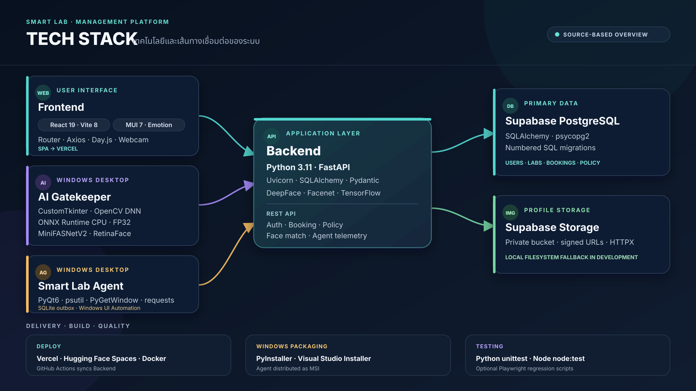
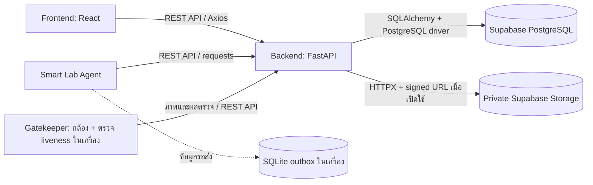

# Tech Stack — ภาพรวมปัจจุบัน

สรุปจาก source code และไฟล์ dependency/config ใน repository นี้ รายละเอียดบางอย่าง เช่น Storage และ API URL ขึ้นกับ environment ที่ใช้รัน

## แต่ละส่วนใช้อะไรและทำอะไร

| ส่วน | เทคโนโลยี | ใช้ทำอะไร |
| --- | --- | --- |
| Frontend | React, Vite, Material UI, React Router, Axios | เว็บ SPA สำหรับสมัคร/เข้าสู่ระบบ จองห้อง และหน้าจัดการของ Admin เรียกข้อมูลจาก Backend ผ่าน REST API |
| Backend | Python 3.11, FastAPI, Uvicorn, SQLAlchemy, Pydantic | API กลางสำหรับ authentication, booking, policy, รายงาน และรับข้อมูลจาก Agent/Gatekeeper; ใช้ DeepFace/Facenet สร้างและเทียบ face embedding |
| Database | Supabase PostgreSQL, psycopg2, SQL migrations | เก็บผู้ใช้, Lab, booking, device/session, policy และประวัติ; ปรับ schema ด้วยไฟล์ migration ที่เรียงเลข |
| รูปโปรไฟล์ | Local filesystem ใน development; Supabase Storage แบบ private เมื่อเปิดใช้ใน production | Backend จัดเก็บรูป และสร้าง signed URL ชั่วคราวให้ Frontend |
| AI Gatekeeper | แอป Windows ด้วย CustomTkinter, OpenCV และ ONNX Runtime CPU | อ่านภาพจากกล้อง ตรวจใบหน้าและ liveness ด้วย MiniFASNetV2; ส่งภาพกับผล liveness ไป Backend เพื่อระบุตัวตนและตรวจสิทธิ์เข้าห้อง |
| Smart Lab Agent | แอป Windows ด้วย PyQt6, psutil, PyGetWindow และ requests | ตรวจโปรแกรม/หน้าต่างและเว็บไซต์ตาม policy แล้วส่ง usage, violation และ heartbeat ไป Backend; พักข้อมูลใน SQLite outbox เมื่อส่งไม่ได้และ retry ภายหลัง |
| อีเมล | Brevo HTTP API | ส่งอีเมล OTP และอีเมลที่เกี่ยวกับการกู้บัญชี |

## ข้อมูลไหลอย่างไร

สรุปการทำงาน: Frontend ไม่ต่อฐานข้อมูลโดยตรง แต่คุยกับ Backend; Gatekeeper ทำ liveness บนเครื่องสแกน ส่วน Backend ทำ face matching และตรวจ booking/การอนุมัติ/ban; Agent เป็นผู้ติดตาม session และการใช้โปรแกรมของเครื่อง Lab

## Build และ Deployment

| ส่วน | วิธีใช้งาน/ส่งขึ้นระบบ |
| --- | --- |
| Frontend | build ด้วย Vite และ deploy บน Vercel |
| Backend | Docker บน Hugging Face Spaces ใช้ Python 3.11 และ Uvicorn; GitHub Actions sync โฟลเดอร์ `backend/` เมื่อ push ไป `main` |
| Agent และ Gatekeeper | สร้าง Windows executable ด้วย PyInstaller; Agent แจกจ่ายเป็น MSI ผ่าน Visual Studio Installer Projects |

## จุดเริ่มดูโค้ดและ dependencies

- Frontend: [`frontend/src/`](../frontend/src/), [`frontend/package.json`](../frontend/package.json)
- Backend: [`backend/main.py`](../backend/main.py), [`backend/routers/`](../backend/routers/), [`backend/requirements.txt`](../backend/requirements.txt)
- Database schema: [`backend/migrations/`](../backend/migrations/)
- Agent: [`smart-lab-agent/agent.pyw`](../smart-lab-agent/agent.pyw), [`smart-lab-agent/requirements.txt`](../smart-lab-agent/requirements.txt)
- Gatekeeper: [`gatekeeper/smart_gatekeeper.py`](../gatekeeper/smart_gatekeeper.py), [`gatekeeper/requirements.txt`](../gatekeeper/requirements.txt)
- วิธีตั้งค่าและรันระบบ: [README หลัก](../README.md)
